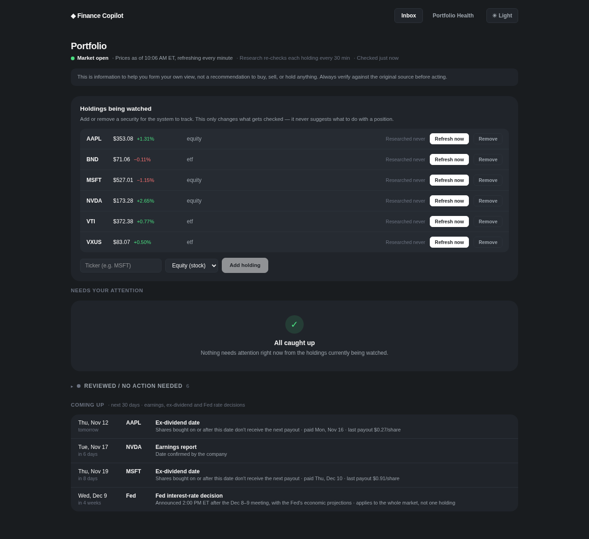
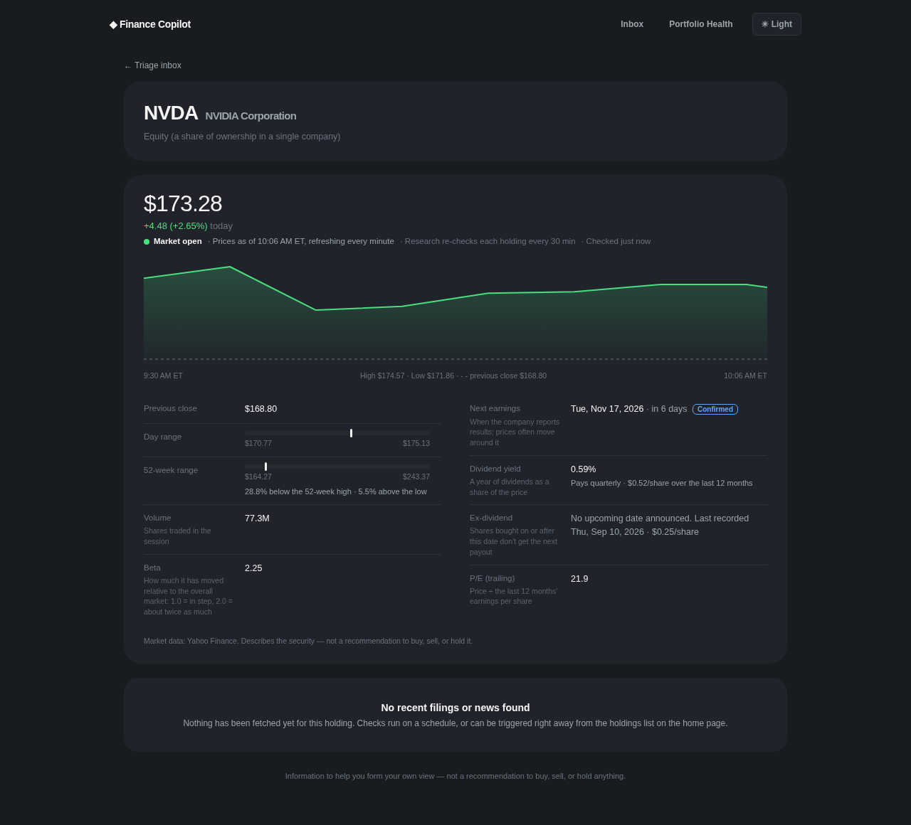
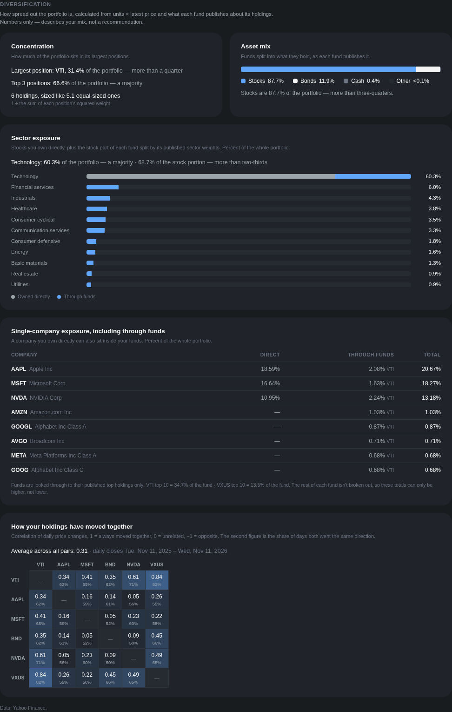

# Finance Copilot — Research Triage + Live Market Data

A personal proof of concept: an AI-assisted research copilot for the
securities you hold. Every 30 minutes it reads each holding's SEC
filings and news, asks a local LLM what changed, and sorts the result
into a triage inbox: **Act**, **Watch**, or **Reviewed**. Every claim
links back to the document it came from.

Alongside the research it shows the market data a holder actually looks
at:
- price action;
- upcoming earnings and ex-dividend dates;
- Fed rate decisions;
- dividend income;
- how diversified the portfolio really is once funds are looked
  through.

Two rules apply everywhere:

- **Information, not instructions.** There is no buy/sell/hold language
  and no scores or verdicts. Signals show their basis, and AI-written
  text cites its sources.
- **Accurate, not performative.** Every price says which session it's
  from. Outside market hours the app says so ("Market closed · Prices
  are from the Fri, Nov 13 4:00 PM ET close"). Only dates that have
  actually been published are shown; nothing is projected. Figures that
  look backwards say so ("not a forecast").

## Pages

### Inbox — what needs my attention? ([`/`](apps/web/src/app/page.tsx))
- **Market status line:**
  - while the market is open, prices refresh every minute;
  - outside the session, it states which close the prices are from.
- **Holdings being watched:**
  - add or remove tickers (stocks, ETFs, treasuries, index funds);
  - each shows its price, its day change, when it was last researched,
    and a *Refresh now* button.
- **Needs your attention:** Act / Watch cards from the latest LLM read.
  - Each card shows the price, the day change, the day's price chart
    (previous close dashed), and a chip for the nearest dated event
    ("Earnings in 6 days").
  - *Mark reviewed* folds a card into the Reviewed group. It's
    browser-only for now: the mark isn't saved.
- **Coming up:** the next 30 days of published earnings dates and
  announced ex-dividend dates across your holdings, plus scheduled Fed
  rate decisions, in date order.

### Holding detail — why is this flagged? ([`/securities/[ticker]`](apps/web/src/app/securities/[ticker]/page.tsx))
- **Market panel:**
  - price and change, with the day's chart;
  - previous close, day range and 52-week range (with where the price
    sits), and volume;
  - beta and trailing P/E;
  - next earnings, marked *Confirmed* or *Estimated*;
  - dividend yield, payment schedule, and the next ex-dividend date
    (or the last recorded one).
  - Every term has an inline explanation.
- **Latest read:** the LLM's summary, event type, sentiment and
  materiality, with "this claim cites" links to the source documents.
  Earlier reads are listed below it.
- **Documents fetched:** the filings and news the reads were built from,
  each linking to the original.

### Portfolio Health — how is it doing? ([`/portfolio-health`](apps/web/src/app/portfolio-health/page.tsx))
Numbers only, no AI text. Every figure is arithmetic on published data.

- **Value and change:**
  - total value (units × latest price), and the change since the
    previous close, in total and per position;
  - an editable *units* column;
  - allocation.
- **Dividend income:**
  - payouts recorded over the last 12 months × the units you hold now;
  - as a yearly total, a share of today's value, and a monthly average;
  - a per-holding breakdown with the next announced ex-dividend date.
- **Diversification:**
  - concentration (largest position, top 3, "sized like N equal
    holdings");
  - asset mix;
  - sector exposure, held directly vs through funds;
  - single-company exposure, including through funds' top holdings;
  - how closely holdings have moved together over 12 months.
  - The only words attached to a number are fractions that are true of
    it ("60.2% — a majority").

## Screenshots

These are from a local stack during market hours, with six test
holdings. Research hasn't run on that stack, so the inbox shows its
empty "All caught up" state.

Inbox: market status, watched holdings with live prices, and Coming up (earnings, ex-dividend dates, the next Fed decision):



Holding detail: NVDA's market panel during the session:



Portfolio Health: value, change today, holdings, and dividend income:


Portfolio Health: diversification, including the fund look-through and the 12-month co-movement grid:



## How it works

```
Browser ──► this app (Next.js, client-side fetches)
               │  NEXT_PUBLIC_FINANCE_API_BASE  (…/api/v1/finance)
               ▼
           Conduit — homelab-hub/services/conduit, `finance` module
               ├─ Postgres: holdings, documents, analyses, schedules
               ├─ every 30 min per holding: finance_ingest
               │     SEC EDGAR filings + Finnhub news (if keyed)
               │     └─ only when something is new: finance_analyze
               │          local Ollama LLM → summary, event type,
               │          sentiment, materiality, citations
               │          (a read citing anything outside the documents
               │           fetched for that run is rejected)
               ├─ /market: Yahoo Finance (keyless), cached
               └─ /market fed_meetings: the Fed's published FOMC calendar
```

The backend is **not in this repo**. It lives in `homelab-hub`, as the
`finance` module of its Conduit service, so the triage pipeline shares
that project's job queue and scheduler.

| Data | Source | Freshness |
|---|---|---|
| Filings | SEC EDGAR | Checked every 30 min per holding |
| News | Finnhub (optional key) | Checked every 30 min, 3-day lookback |
| AI read | Local Ollama LLM | Re-run only when new documents arrive |
| Prices, intraday, ranges, volume | Yahoo Finance | 45 s server cache; browser polls every 1 min (open), 5 min (pre/after hours), 15 min (closed) |
| Earnings dates, ex-dividend dates, yield, beta, P/E | Yahoo Finance | 30 min cache |
| Dividend history, 2 years of daily closes | Yahoo Finance | 6 h cache |
| Fund make-up (asset split, sectors, top 10) | Yahoo Finance | 24 h cache |
| Fed rate-decision dates | federalreserve.gov | 24 h cache |

Yahoo's endpoints are unofficial. If one fails, only the figures from
that call disappear; the rest of the page keeps working.

## Running it locally

You need a running Conduit (from `homelab-hub`) with the finance module.
Then point this app at it:

```bash
npm install
NEXT_PUBLIC_FINANCE_API_BASE=http://localhost:8080/api/v1/finance \
  npm run dev --workspace=apps/web
# http://localhost:3000
```

The browser calls Conduit directly. Conduit allows `localhost` and
`127.0.0.1` origins (any port) for local development.

`NEXT_PUBLIC_FINANCE_API_BASE` is inlined into the client bundle at
**build** time. Changing it means rebuilding, not just restarting.

Production build:

```bash
NEXT_PUBLIC_FINANCE_API_BASE=… npm run build --workspace=apps/web
npm run start --workspace=apps/web
```

## Deploying

A single container ([`Dockerfile`](Dockerfile),
[`docker-compose.yml`](docker-compose.yml)) published on host port
3210. Set `NEXT_PUBLIC_FINANCE_API_BASE` in `.env` (see
[`.env.example`](.env.example)). Compose passes it as a **build arg**,
so run `docker compose build` after changing it.

In production the public site serves the app and proxies
`/api/v1/finance/*` to Conduit on the same domain. That keeps the API
same-origin, so no CORS is needed and viewers don't need VPN access.
See [`docs/deployment.md`](docs/deployment.md) for the reverse-proxy
setup.

## Structure

```
ai-finance-risk-analysis/
├── apps/web/src/
│   ├── app/
│   │   ├── page.tsx                 # Inbox
│   │   ├── portfolio-health/        # Portfolio Health
│   │   └── securities/[ticker]/     # Holding detail
│   ├── components/
│   │   ├── HoldingsManager.tsx      # watched holdings: add/remove/refresh, price + change
│   │   ├── LiveHoldingDetailView.tsx, SecurityDetailClient.tsx
│   │   ├── MarketPanel.tsx          # detail-page market data
│   │   ├── MarketStatus.tsx         # the honest open/closed line
│   │   ├── PriceChart.tsx           # intraday sparkline + session chart (inline SVG)
│   │   ├── UpcomingEvents.tsx       # Coming up
│   │   ├── DividendIncome.tsx
│   │   ├── DiversificationSection.tsx
│   │   ├── useMarket.ts             # market-clock polling
│   │   └── SiteNav.tsx, ThemeToggle.tsx
│   └── lib/
│       ├── live-finance.ts          # API client + types mirroring Conduit's JSON
│       ├── market.ts                # market wording, formatting, event and fraction rules
│       ├── triage.ts                # inbox card type
│       └── format.ts
├── design/mockups/                  # approved static-HTML mockups (reference only)
│   └── FUTURE-FEATURES.md           # considered, not built (and declined) ideas
├── docs/
│   ├── adr/                         # decision records, 0001–0018
│   ├── deployment.md
│   └── screenshots/
├── Dockerfile, docker-compose.yml, .env.example
└── package.json                     # npm workspaces root
```

## Decision history

[`docs/adr/`](docs/adr/) records every reframe and why. In short:

- **0001–0014:** a mock-data POC that went through several product
  shapes. It started as a risk dashboard and per-security comparison,
  then became a retirement persona, then a research copilot with a
  triage inbox. ADR 0012 trimmed it to three pages; 0013–0014 set the
  visual system.
- **0015:** live data. The finance module was added in Conduit, and
  holdings became dynamic.
- **0016:** active market data and a 30-minute research cadence, with
  honest market-status wording.
- **0017:** diversification on Portfolio Health, numbers only.
- **0018:** dividend income and Fed rate decisions, chosen from a survey
  of other portfolio sites.

Superseded ADRs are kept as written, as a record.

## Tech

- [Next.js](https://nextjs.org) 16 (App Router, TypeScript, Tailwind
  CSS v4), with dark and light themes (ADR 0014).
- All charts are inline SVG; there's no charting library.
- Backend: Go (Conduit) + Postgres + a local Ollama model, in
  `homelab-hub`.
