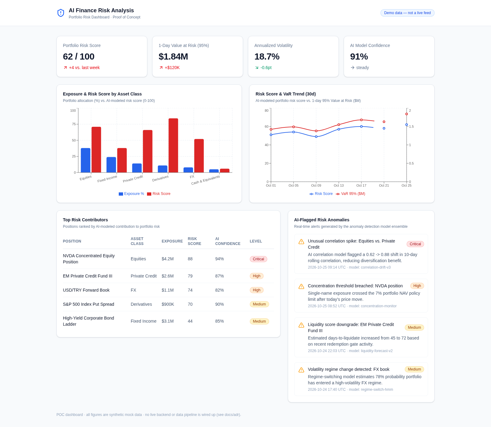
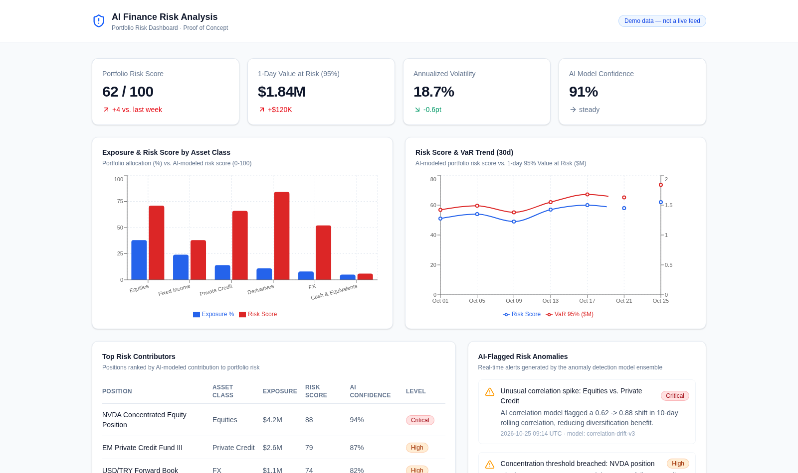

# AI Finance Risk Analysis — Dashboard POC

A proof-of-concept dashboard illustrating what an AI-driven portfolio risk
analysis product could look like: risk scores, Value at Risk, exposure by
asset class, risk/VaR trend, top risk contributors, and an AI-flagged
anomaly feed.

**This is a POC with no backend, no data pipeline, and no real data.**
Everything on screen is synthetic/mock data defined in
[`apps/web/src/lib/mock-data.ts`](apps/web/src/lib/mock-data.ts). See
[`docs/adr/0001-poc-scope-no-plumbing.md`](docs/adr/0001-poc-scope-no-plumbing.md)
for why, and the rest of [`docs/adr/`](docs/adr/) for the other decisions
behind this build.

## Screenshots

Full page:



Above-the-fold viewport:



## Structure

```
ai-finance-risk-analysis/
├── apps/
│   └── web/              # Next.js (App Router) dashboard
│       └── src/
│           ├── app/              # page.tsx, layout.tsx
│           ├── components/       # SummaryCard, RiskCharts, TopContributorsTable, AnomalyFeed, RiskBadge
│           └── lib/mock-data.ts  # all dashboard data (synthetic)
├── docs/
│   ├── adr/               # architecture decision records
│   └── screenshots/       # dashboard screenshots (this README embeds them)
└── package.json            # npm workspaces root
```

## Running it locally

```bash
npm install
npm run dev --workspace=apps/web
# http://localhost:3000
```

Production build:

```bash
npm run build --workspace=apps/web
npm run start --workspace=apps/web
```

## Tech

- [Next.js](https://nextjs.org) 16 (App Router, TypeScript, Tailwind CSS v4)
- [Recharts](https://recharts.org) for the exposure and risk-trend charts
- [lucide-react](https://lucide.dev) for icons

See [`docs/adr/`](docs/adr/) for the reasoning behind each of these choices.
