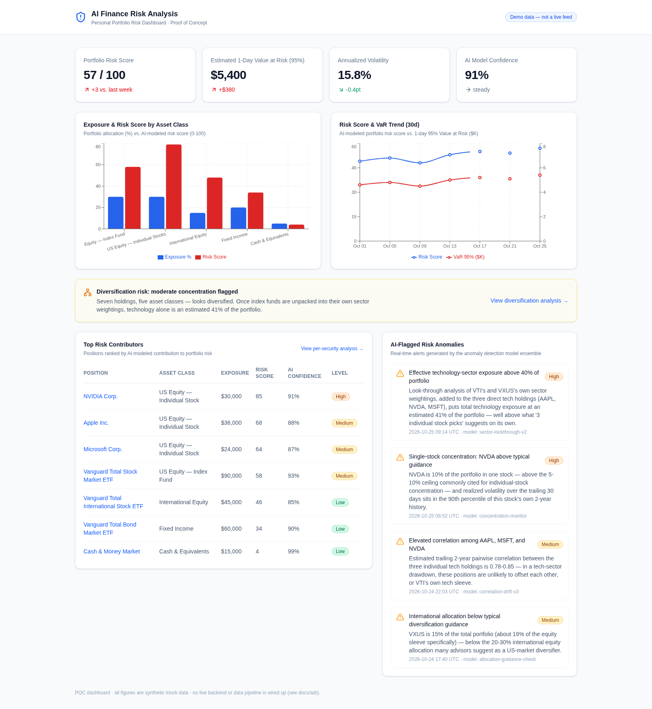
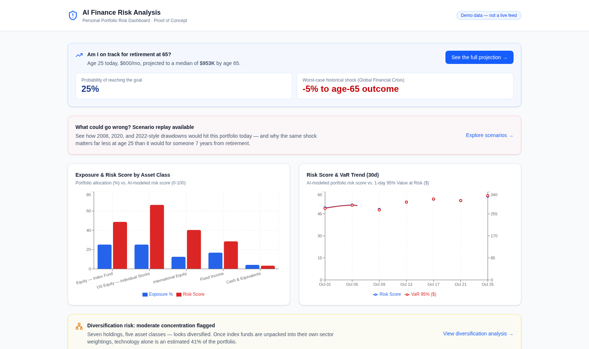
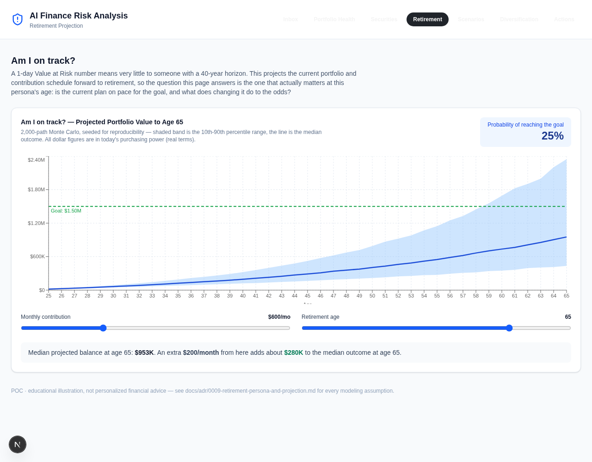
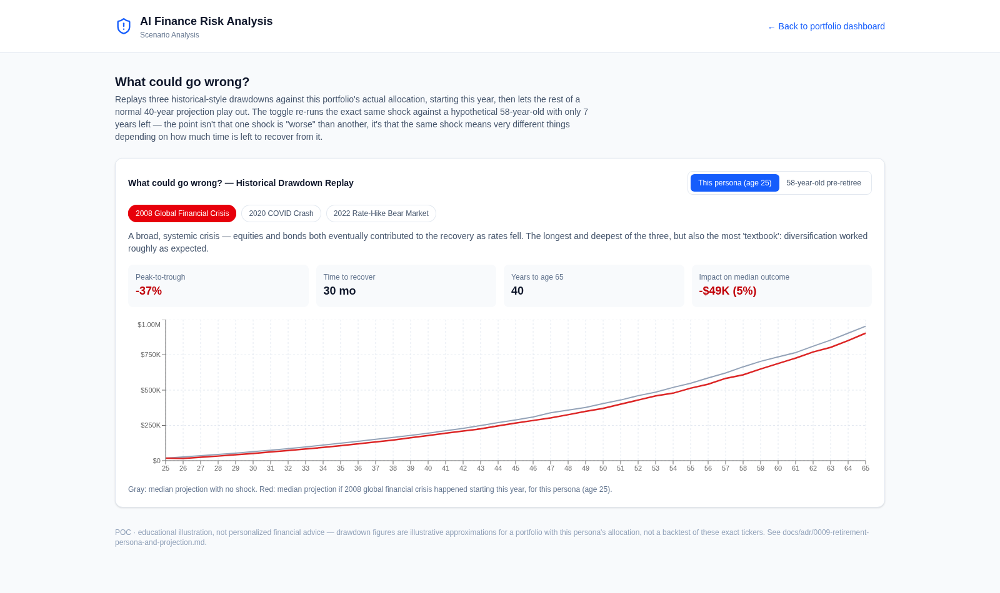
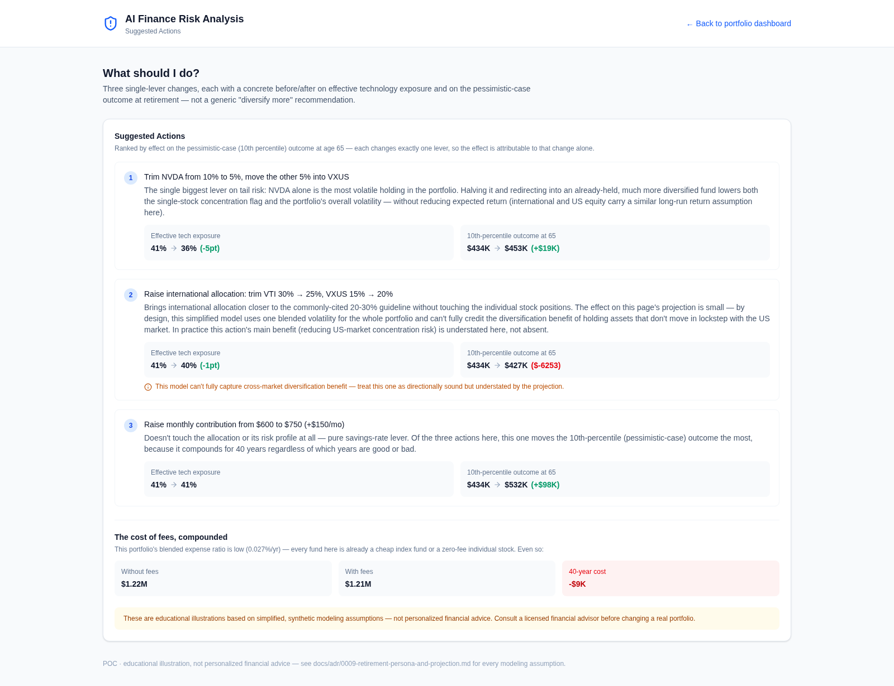
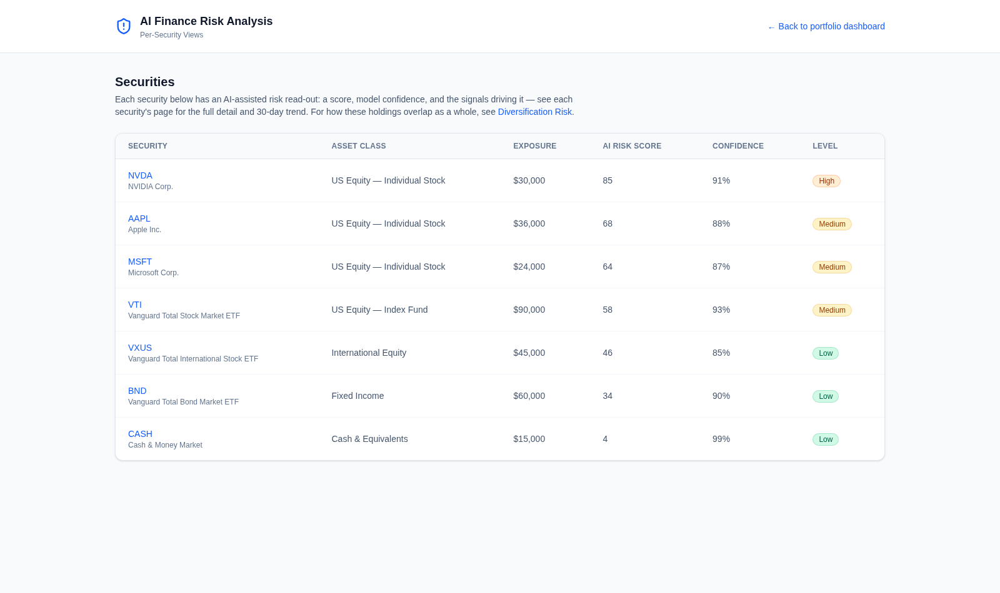
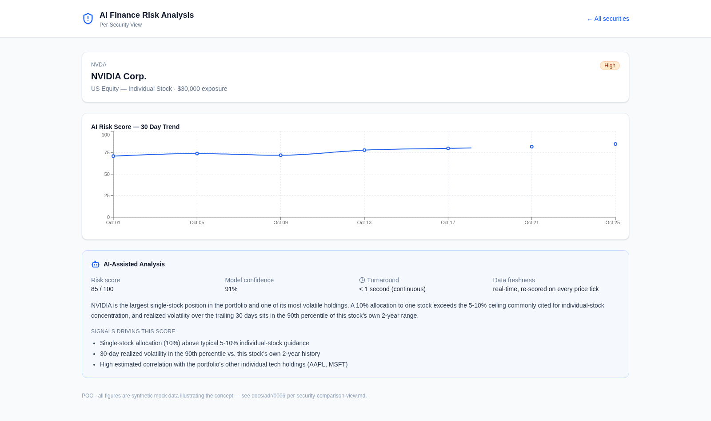
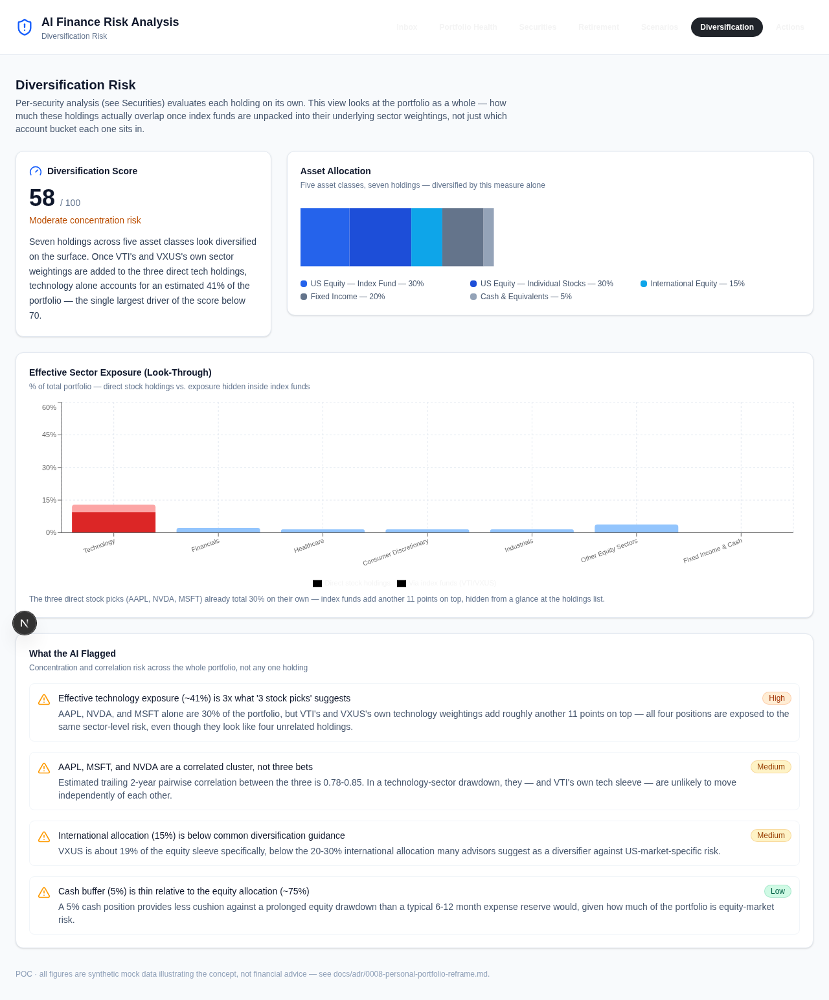

# AI Finance Risk Analysis — Dashboard POC

A proof-of-concept dashboard illustrating what an AI-driven personal
portfolio risk analysis product could look like for one hypothetical
early-career retirement investor: age 25, a $18,000 brokerage account
(7 holdings), contributing $600/month toward a $1.5M goal at 65.

A 1-day Value at Risk number and a 0-100 risk score matter very little
to someone with a 40-year horizon, so the dashboard is built around four
questions a long-term investor actually asks:

- **Am I on track?** ([`/retirement`](apps/web/src/app/retirement/page.tsx)) —
  a seeded Monte Carlo projection to age 65 (10th/50th/90th percentile
  fan chart against the goal), with live sliders for contribution and
  retirement age.
- **What could go wrong?** ([`/scenarios`](apps/web/src/app/scenarios/page.tsx)) —
  2008/2020/2022-style drawdowns replayed against this persona's actual
  allocation, with a toggle comparing the same shock against a
  hypothetical 58-year-old pre-retiree to show why horizon matters.
- **Why is it flagged?** (dashboard + [`/diversification`](apps/web/src/app/diversification/page.tsx)) —
  every AI risk flag explained in three parts (what it means, why it
  matters at this horizon, what's driving it), plus a visual showing
  how much of the portfolio's technology exposure is hidden inside
  index funds vs. held directly.
- **What should I do?** ([`/actions`](apps/web/src/app/actions/page.tsx)) —
  three ranked, single-lever suggestions (each with a before/after on
  tech exposure and on the pessimistic-case outcome at 65), plus what
  fee drag costs over 40 years even on a low-cost portfolio.

**This is a POC with no backend, no data pipeline, and no real data.**
Everything on screen is synthetic/mock data defined in
[`apps/web/src/lib/mock-data.ts`](apps/web/src/lib/mock-data.ts). See
[`docs/adr/0001-poc-scope-no-plumbing.md`](docs/adr/0001-poc-scope-no-plumbing.md)
for why, and the rest of [`docs/adr/`](docs/adr/) for the decisions
behind this build —
[`docs/adr/0009-retirement-persona-and-projection.md`](docs/adr/0009-retirement-persona-and-projection.md)
documents the persona and **every modeling assumption** behind the
projection, scenario replay, and suggested-action math, worked out by
hand so it's auditable rather than a black box.

## Screenshots

Dashboard — full page:



Dashboard — above-the-fold viewport:



Am I on track? — retirement projection with live sliders:



What could go wrong? — historical drawdown replay with horizon comparison:



What should I do? — ranked suggested actions and fee drag:



Per-security view — every holding ranked by AI risk score, with model
confidence:



One holding in depth — AI-assisted risk read-out, the signals driving
it, and a 30-day trend:



Diversification risk — the portfolio-level view: a diversification
score, asset allocation, effective sector exposure once index funds
are looked through (direct holdings vs. via index funds), and what
the AI flagged:



## Structure

```
ai-finance-risk-analysis/
├── apps/
│   └── web/              # Next.js (App Router) dashboard
│       └── src/
│           ├── app/              # page.tsx, retirement/, scenarios/,
│           │                     # actions/, securities/, diversification/
│           ├── components/       # SummaryCard, RiskCharts, TopContributorsTable,
│           │                     # AnomalyFeed, RiskBadge, AIAnalysisPanel,
│           │                     # RetirementProjection, ScenarioExplorer,
│           │                     # SuggestedActions, DiversificationCharts,
│           │                     # DiversificationScoreCard
│           └── lib/
│               ├── mock-data.ts  # all dashboard data (synthetic)
│               └── projection.ts # seeded Monte Carlo + scenario/fee-drag math
├── docs/
│   ├── adr/               # architecture decision records
│   └── screenshots/       # dashboard screenshots (this README embeds them)
└── package.json            # npm workspaces root
```

## Running it locally

```bash
npm install
npm run dev --workspace=apps/web
# http://localhost:3000
```

Production build:

```bash
npm run build --workspace=apps/web
npm run start --workspace=apps/web
```

## Tech

- [Next.js](https://nextjs.org) 16 (App Router, TypeScript, Tailwind CSS v4)
- [Recharts](https://recharts.org) for every chart (exposure, risk-trend,
  retirement projection fan chart, scenario replay, sector exposure)
- [lucide-react](https://lucide.dev) for icons

See [`docs/adr/`](docs/adr/) for the reasoning behind each of these choices.
