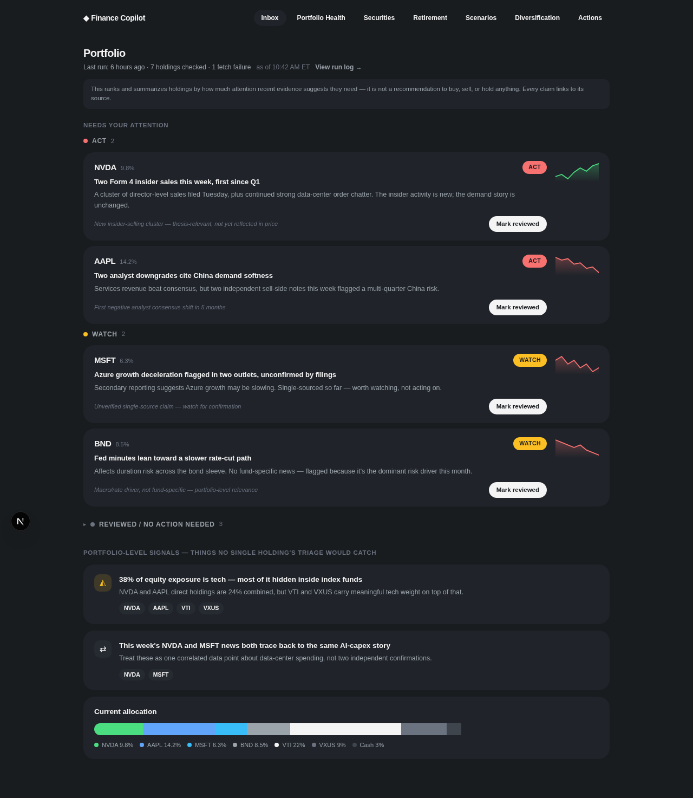
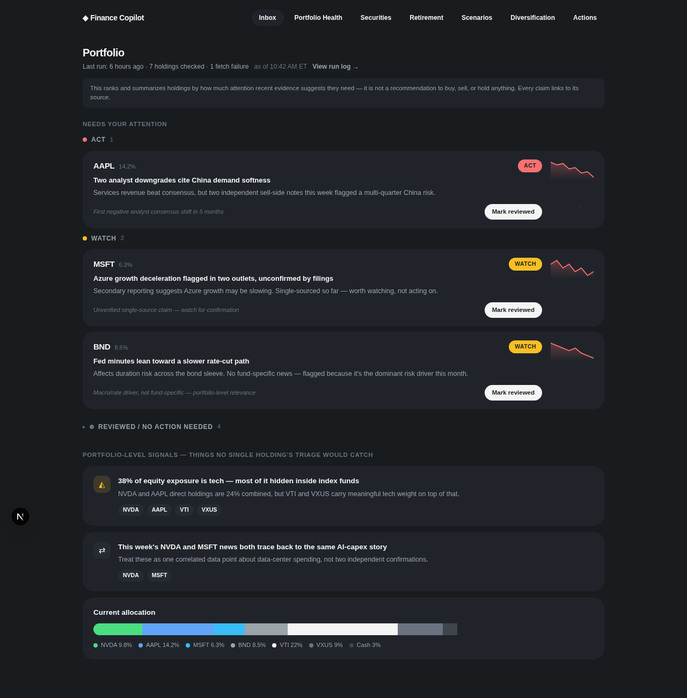
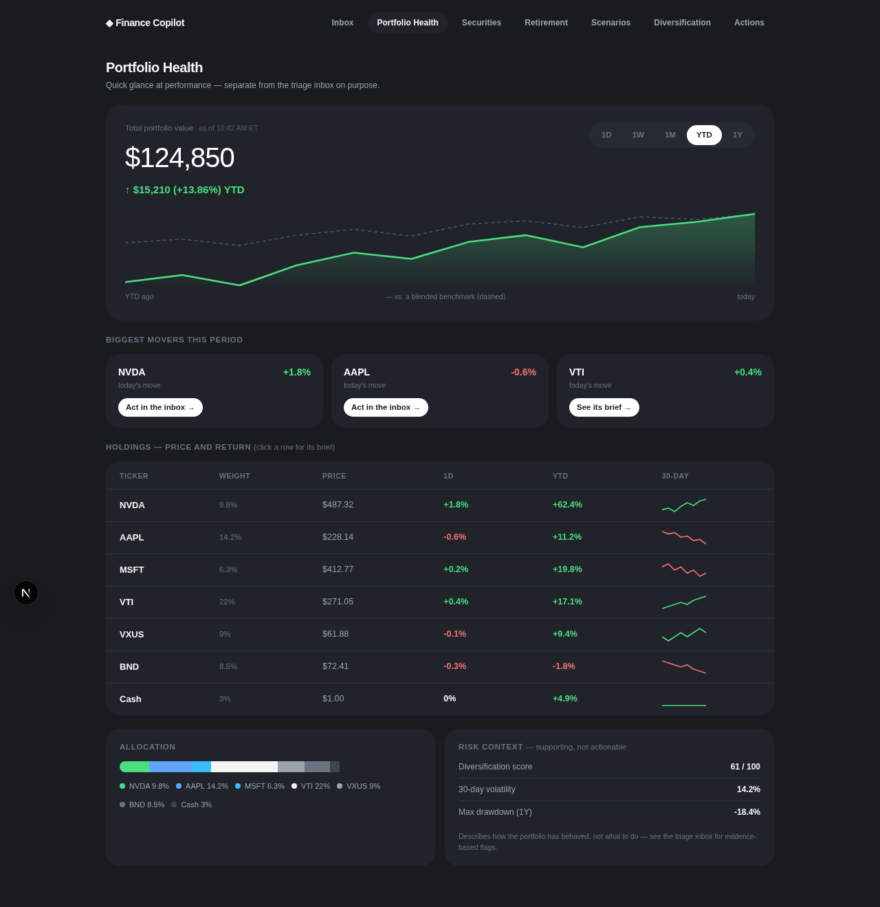
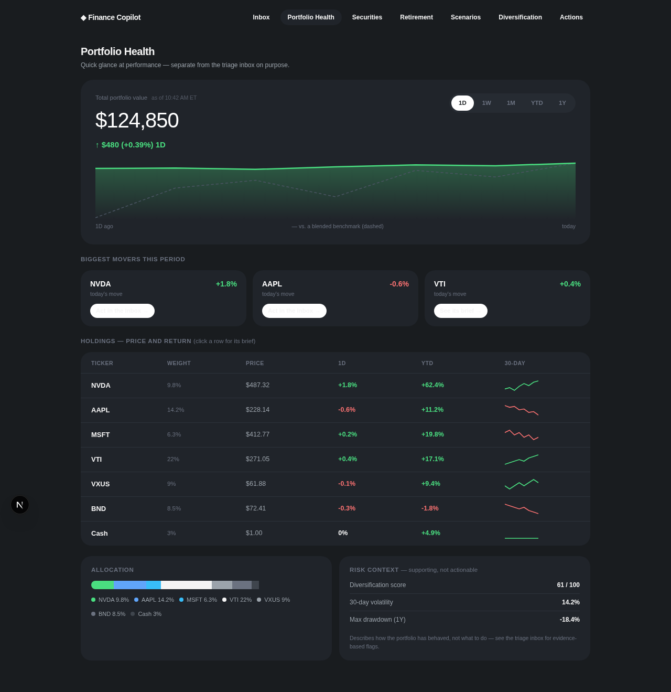
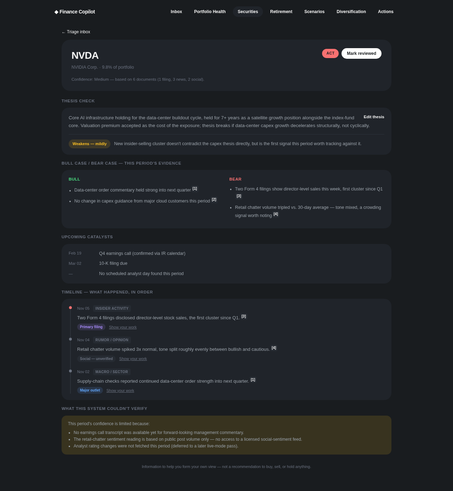
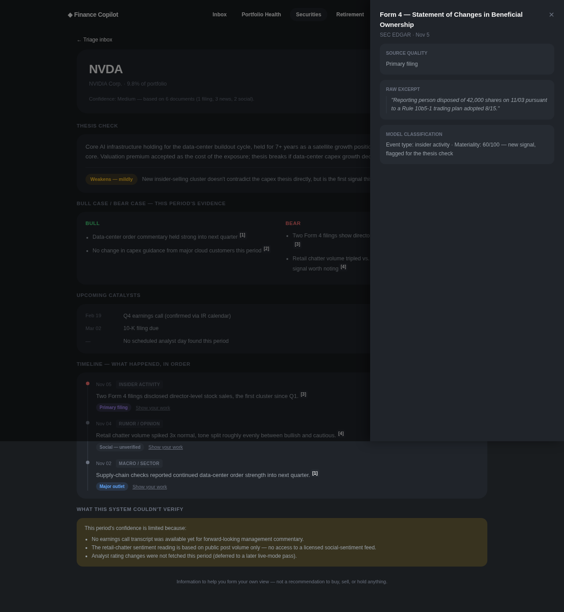

# Finance Copilot — Research Triage POC

A proof-of-concept AI-assisted portfolio research copilot for one
hypothetical early-career retirement investor: age 25, a $18,000
brokerage account across 7 holdings — NVDA, AAPL, MSFT, VTI, VXUS, BND,
Cash.

The app is a triage-first workflow, not a static risk dashboard: what
needs attention right now, with every claim traceable to a source.
Visual system is a dark "Confident Flat" theme — see
[`docs/adr/0011-triage-inbox-visual-implementation.md`](docs/adr/0011-triage-inbox-visual-implementation.md)
for the build record,
[`docs/adr/0012-scope-narrowing.md`](docs/adr/0012-scope-narrowing.md)
for why the app is now exactly three pages (it used to carry five
unrelated risk-dashboard-era routes under the old "AI Finance Risk
Analysis" name, since removed), and
[`design/mockups/clickable-triage.html`](design/mockups/clickable-triage.html),
[`clickable-health.html`](design/mockups/clickable-health.html), and
[`clickable-detail.html`](design/mockups/clickable-detail.html) for the
literal approved spec these three pages implement.

- **What needs my attention?** ([`/`](apps/web/src/app/page.tsx), the
  landing page — "Inbox" in the nav) — every holding grouped into
  Act / Watch / Reviewed (no action needed), each item carrying a
  headline, a one-line summary, and the specific reason it was
  flagged. "Mark reviewed" is a real client-side interaction (no
  persistence — POC). Below the queue, portfolio-level signals
  (concentration hidden inside index funds, correlated news across
  holdings) surface cross-holding analysis no single item's triage
  would catch, plus the current allocation breakdown. Never a
  buy/sell/hold call — every claim is framed as evidence to form your
  own view from, with a stated basis.
- **How is it doing?** ([`/portfolio-health`](apps/web/src/app/portfolio-health/page.tsx)) —
  a deliberately separate page from the inbox (triage changes when
  news drops; this changes when the market moves). Hero total-value
  chart with a 1D/1W/1M/YTD/1Y toggle (the chart's accent color always
  follows the actual sign of the period's change, never hardcoded),
  biggest movers linking back into the inbox or a holding's brief,
  a holdings price/return table, an allocation bar, and risk context
  (diversification score, volatility, max drawdown) demoted to a small
  card explicitly labeled "describes behavior, not instruction."
- **Why is this holding flagged, and what's the evidence?**
  ([`/securities/[ticker]`](apps/web/src/app/securities/[ticker]/page.tsx)) —
  a thesis check with a verdict chip (weakens/supports/neutral,
  always paired with its reason — never a bare rating), bull case /
  bear case with inline citation markers, upcoming catalysts, a
  chronological timeline, an explicit "what this system couldn't
  verify" disclosure, and a per-citation "show your work" drawer
  (raw excerpt, source-quality tag, model classification). Covers all
  7 holdings, including the two low-activity index funds and Cash,
  which render minimal pages rather than breaking.

**This is a POC with no backend, no data pipeline, and no real data.**
Everything on screen is synthetic/mock data defined in
[`apps/web/src/lib/mock-data.ts`](apps/web/src/lib/mock-data.ts) (news/
sentiment/tax-flag fixtures feeding the relevance ranking) and
[`apps/web/src/lib/triage.ts`](apps/web/src/lib/triage.ts) (the inbox,
Portfolio Health, and holding-detail content — copied verbatim from the
approved mockups, not invented). See
[`docs/adr/0001-poc-scope-no-plumbing.md`](docs/adr/0001-poc-scope-no-plumbing.md)
for why, and the rest of [`docs/adr/`](docs/adr/) for the full decision
history — including ADRs 0002-0009, which cover product directions
(retirement projection, scenario replay, diversification scoring) that
were built, then removed per ADR 0012; those ADRs are left unedited as
a historical record, not retconned.

## Screenshots

Inbox — the landing page, Act/Watch triage queue with portfolio-level signals:



Inbox — after marking an item reviewed (client-side state, no persistence):



Portfolio Health — hero value chart, movers, holdings table, allocation, risk context:



Portfolio Health — 1D timeframe selected (chart color follows the actual sign):



Holding detail — NVDA's thesis check, bull/bear evidence, catalysts, and timeline:



Holding detail — a citation's "show your work" drawer open:



## Structure

```
ai-finance-risk-analysis/
├── apps/
│   └── web/              # Next.js (App Router) app
│       └── src/
│           ├── app/              # page.tsx (inbox), portfolio-health/,
│           │                     # securities/[ticker]/  — exactly 3 routes
│           ├── components/       # HoldingDetailView, SiteNav
│           └── lib/
│               ├── mock-data.ts  # persona + news/sentiment/tax-flag fixtures
│               ├── triage.ts     # inbox, Portfolio Health, holding-detail data
│               └── digest.ts     # pure relevance-ranking function
├── design/
│   └── mockups/           # approved static-HTML design mockups (reference only,
│                           # not shipped code) — clickable-triage.html,
│                           # clickable-health.html, clickable-detail.html are the
│                           # literal spec apps/web implements
├── docs/
│   ├── adr/               # architecture decision records
│   └── screenshots/       # app screenshots (this README embeds them)
└── package.json            # npm workspaces root
```

## Running it locally

```bash
npm install
npm run dev --workspace=apps/web
# http://localhost:3000
```

Production build:

```bash
npm run build --workspace=apps/web
npm run start --workspace=apps/web
```

## Tech

- [Next.js](https://nextjs.org) 16 (App Router, TypeScript, Tailwind CSS v4)
- All charts (hero value, holdings sparklines, mover cards) are inline
  SVG per the approved mockups — no charting library dependency

See [`docs/adr/`](docs/adr/) for the reasoning behind each of these choices.
